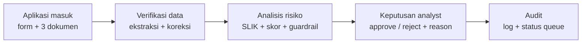
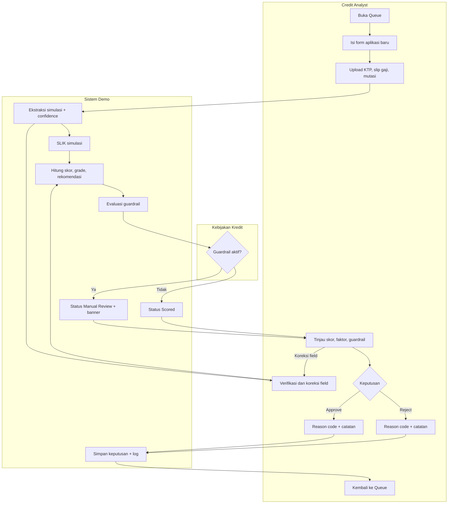
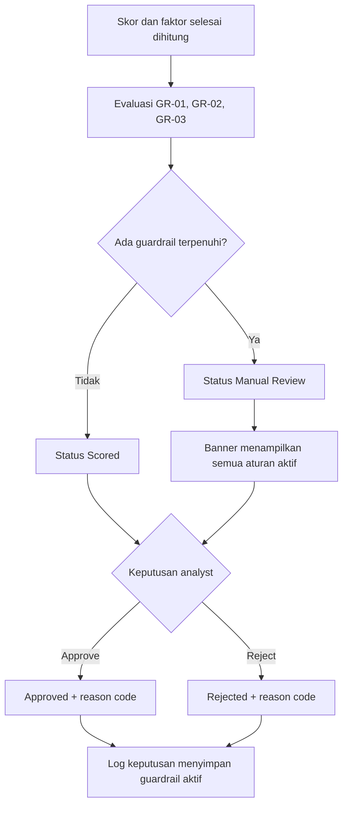
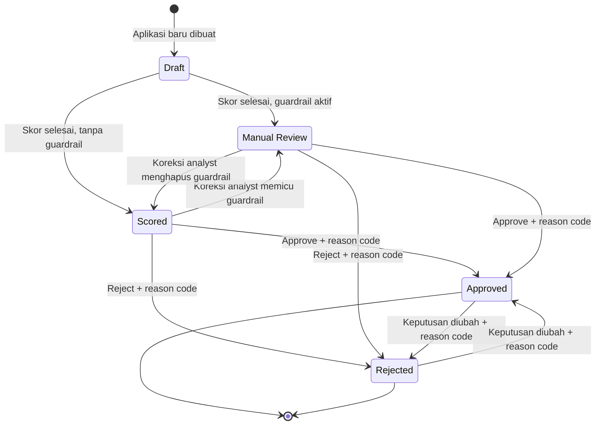

# Business Requirements Document (BRD)
## AI Credit Scoring Assistant — Demo

| Item | Keterangan |
|---|---|
| Nama Proyek | AI Credit Scoring Assistant (nama kerja; branding belum ditetapkan, lihat OQ-02) |
| Versi Dokumen | 0.6 |
| Tanggal | 19 November 2026 |
| Status | Diimplementasikan sebagai demo |
| Pemilik Bisnis | Belum ditetapkan |

### Riwayat Revisi

| Versi | Tanggal | Perubahan |
|---|---|---|
| 0.1 | 16-11-2026 | Draft awal |
| 0.2 | 16-11-2026 | Scope dipangkas untuk demo singkat; tanpa database, service terpisah, dan roadmap fase |
| 0.3 | 16-11-2026 | Menambahkan diagram alur bisnis: overview proses, swimlane, guardrail/keputusan, dan siklus status |
| 0.4 | 16-11-2026 | Selaraskan cakupan tiga layar, rekomendasi grade C, ID guardrail, field mutasi, dan transisi perubahan keputusan dengan PRD v0.3 |
| 0.5 | 17-11-2026 | Tambah backend minimal (route handlers + file JSON), PWA installable, dan deliverable QA/presentasi untuk submission |
| 0.6 | 19-11-2026 | Selaraskan dengan implementasi: transisi status setelah koreksi, teks rekomendasi, profil demo, dan bagian Dokumen di detail |

---

## 1. Ringkasan

Aplikasi web untuk **credit analyst** multifinance/BNPL yang menampilkan skor kredit, alasan skor, dan rekomendasi keputusan. AI bersifat **advisory**: analyst tetap mengambil keputusan akhir.

Ini **demo singkat**, bukan produk. Tujuan: menunjukkan alur review dan nilai explainability kepada stakeholder. Seluruh data sintetis.

---

## 2. Masalah & Tujuan

**Masalah:** review aplikasi BNPL memakan waktu, keputusan antar analyst tidak konsisten, dan alasan keputusan sulit dijelaskan.

**Tujuan demo:**
1. Menunjukkan review satu aplikasi dari upload sampai keputusan dalam < 5 menit.
2. Menunjukkan skor yang dapat dijelaskan (faktor kontribusi), bukan angka tanpa alasan.
3. Menunjukkan guardrail kebijakan dan jejak keputusan analyst.

---

## 3. Ruang Lingkup

### 3.1 In Scope

- Satu aplikasi web responsive (desktop + browser mobile) yang juga installable sebagai **PWA**.
- Backend minimal di aplikasi yang sama: route handlers Next.js + penyimpanan file JSON di server.
- Tiga layar: **Queue**, **Aplikasi Baru**, dan **Detail Aplikasi**.
- Upload KTP, slip gaji, mutasi rekening.
- Ekstraksi dokumen **simulasi** (tanpa OCR) dengan confidence per field dan koreksi manual.
- SLIK **simulasi** per profil.
- Skor 0–1000, grade A–E, rekomendasi plafon/tenor.
- Lima faktor kontribusi utama.
- Tiga guardrail kebijakan.
- Keputusan analyst + reason code + log keputusan sederhana.
- Lima profil dummy, data di server lokal, tanpa database.
- Deliverable submission: Testing Plan, test scenario, automated tests, QA report, dan presentasi.

### 3.2 Out of Scope

- OCR/e-KYC, integrasi SLIK/bureau nyata, integrasi LOS.
- Database eksternal, autentikasi, multi-role, approval berjenjang.
- Dashboard portofolio, what-if simulator, ekspor PDF.
- Aplikasi mobile native/PWA terpisah; yang dibangun hanya PWA dari web app.
- Training model, MLOps, monitoring produksi.
- Data nyata atau data pribadi.

---

## 4. Pengguna

**Credit Analyst** — memproses aplikasi BNPL, memahami SLIK dan dokumen penghasilan, ingin rekomendasi yang bisa dijelaskan, dan bertanggung jawab atas keputusan akhir.

---

## 5. Alur Bisnis

Diagram di bagian ini menggambarkan proses bisnis, bukan detail implementasi. Perilaku layar dan komponen mengikuti PRD.

### 5.1 Langkah demo

1. Analyst membuka **Queue** → melihat 5 aplikasi dummy.
2. Klik **Aplikasi Baru** → isi data pengajuan → upload KTP, slip gaji, mutasi.
3. Sistem menampilkan **hasil ekstraksi simulasi** + confidence; analyst dapat mengoreksi.
4. **SLIK simulasi** tampil otomatis.
5. **Skor, grade, rekomendasi** muncul.
6. Analyst melihat **faktor risiko** dan **guardrail**.
7. Analyst memilih **Approve / Reject** + reason code → keputusan tercatat di log.

### 5.2 Overview proses

### 5.3 Alur end-to-end (swimlane)

### 5.4 Alur guardrail dan keputusan

Semua guardrail dievaluasi. Jika lebih dari satu terpenuhi, semuanya ditampilkan pada banner.

### 5.5 Siklus status aplikasi

Status dan transisi mengikuti PRD §8.1 dan §13. Koreksi ekstraksi menghitung ulang skor selama aplikasi belum Approved atau Rejected; setelah keputusan final, koreksi ditolak. Perubahan keputusan, termasuk mencatat ulang keputusan yang sama, menambah entri log tanpa menghapus entri sebelumnya. Diagram hanya merangkum transisi yang didukung demo.

---

## 6. Kebutuhan Fungsional

| ID | Requirement | Prioritas |
|---|---|---|
| FR-01 | Queue menampilkan daftar aplikasi: nama, plafon, skor, grade, status | Must |
| FR-02 | Form aplikasi baru: produk, plafon, tenor, DP, tujuan | Must |
| FR-03 | Upload KTP, slip gaji, mutasi (JPG/PNG/PDF, maks 10 MB/file) | Must |
| FR-04 | Ekstraksi simulasi per profil dengan confidence; field dapat diedit | Must |
| FR-05 | SLIK simulasi: lender, plafon, baki debet, kolektibilitas 1–5 | Must |
| FR-06 | Skor 0–1000, grade A–E, rekomendasi plafon/tenor | Must |
| FR-07 | Lima faktor kontribusi (poin + arah) dan narasi singkat | Must |
| FR-08 | Guardrail menandai aplikasi sebagai **Manual Review** beserta alasannya | Must |
| FR-09 | Keputusan Approve/Reject + reason code + catatan | Must |
| FR-10 | Log keputusan: waktu, aplikasi, keputusan, reason code | Must |
| FR-11 | Label **"Demo Mode: data simulasi"** di semua halaman | Must |
| FR-12 | Layout responsive 390px–1440px | Must |
| FR-13 | API lokal untuk baca/tulis aplikasi dan persistensi file JSON | Must |
| FR-14 | Web app installable sebagai PWA (manifest + service worker) | Should |

**Reason code:** `INCOME_INSUFFICIENT`, `DTI_EXCEEDED`, `DELINQUENCY`, `THIN_FILE`, `DOC_MISMATCH`, `OTHER`.

---

## 7. Layar

### 7.1 Queue
Daftar aplikasi dummy dengan skor, grade, dan status. Tombol "Aplikasi Baru".

### 7.2 Aplikasi Baru
Form data pengajuan dan tiga slot upload dokumen, dilanjutkan ekstraksi simulasi dan perhitungan skor.

### 7.3 Detail Aplikasi
Satu halaman dengan bagian:
- **Ringkasan** — skor, grade, rekomendasi, status guardrail.
- **Dokumen** — nama file yang diunggah, hasil ekstraksi + confidence.
- **SLIK** — ringkasan fasilitas dan kolektibilitas.
- **Faktor Risiko** — kontribusi faktor + narasi.
- **Keputusan** — Approve/Reject, reason code, catatan.

---

## 8. Scoring & Guardrail

### 8.1 Fitur

| Fitur | Arah Risiko |
|---|---|
| DTI | Naik = risiko naik |
| Rasio cicilan existing | Naik = risiko naik |
| Stabilitas income (6 bulan) | Variasi tinggi = risiko naik |
| Kredibilitas slip gaji vs mutasi | Selisih besar = risiko naik |
| Kolektibilitas terburuk (SLIK) | ≥ 3 = guardrail |
| Keterlambatan 12 bulan | Naik = risiko naik |

### 8.2 Skor

| Rentang | Grade | Rekomendasi |
|---|---|---|
| 800–1000 | A | Approve, plafon sesuai pengajuan |
| 700–799 | B | Approve, plafon maks 80% pengajuan |
| 600–699 | C | Manual review, plafon maks 50% pengajuan |
| 500–599 | D | Manual review atau approve bersyarat |
| < 500 | E | Rekomendasi reject |

Model: scorecard berbobot tetap (aditif), sehingga kontribusi tiap faktor dapat ditampilkan tanpa library tambahan. Bobot bersifat demo.

### 8.3 Guardrail

| ID | Aturan | Konsekuensi |
|---|---|---|
| GR-01 | Kolektibilitas ≥ 3 | Manual Review |
| GR-02 | DTI > 50% | Manual Review |
| GR-03 | Telat 90+ hari dalam 12 bulan | Manual Review |

---

## 9. Data Demo

Lima profil sintetis yang tertanam di seed aplikasi (`02_source/lib/seed.ts`):

| ID | Profil | Grade | Kasus |
|---|---|---|---|
| C-01 | Karyawan tetap, riwayat bersih | A | Happy path |
| C-02 | Karyawan tetap, DTI moderat | B | Approve limit disesuaikan |
| C-03 | Karyawan, income dan slip-mutasi fluktuatif | C | Stabilitas income |
| C-04 | Telat 2 kali dalam 12 bulan, dua lender | D | Delinquency ringan |
| C-05 | Kolektibilitas 3 | E | Guardrail |

Field ekstraksi:
- **KTP:** nama, NIK, tanggal lahir.
- **Slip gaji:** employer, THP, masa kerja.
- **Mutasi:** rata-rata saldo, inflow bulanan, cicilan terdeteksi.
- **SLIK:** lender, plafon, baki debet, kolektibilitas, telat 12 bulan.

Setiap field ekstraksi punya confidence 0–1; di bawah 0,80 ditandai.

---

## 10. Non-Fungsional (Minimal)

| ID | Requirement |
|---|---|
| NFR-01 | Skor dihitung < 1 detik |
| NFR-02 | Halaman termuat < 3 detik di lokal |
| NFR-03 | Responsive 390px–1440px |
| NFR-04 | Bahasa Indonesia, format Rupiah |
| NFR-05 | Tidak ada data pribadi nyata; label demo terlihat |
| NFR-06 | Tanpa login; akses lokal/demo |

---

## 11. Asumsi

- Produk BNPL, plafon Rp 5–50 juta, tenor 3–24 bulan.
- Satu pengguna (analyst), tanpa role lain.
- Branding netral.
- Semua parameter skor dan guardrail adalah usulan demo.
- Demo dijalankan lokal.

---

## 12. Risiko

| Risiko | Mitigasi |
|---|---|
| Data simulasi disalahartikan sebagai data nyata | Label "Demo Mode" permanen |
| Skor dianggap keputusan final | Framing advisory; keputusan tetap oleh analyst |
| Scope melebar (OCR, dashboard, mobile app) | Daftar out-of-scope di atas |

---

## 13. Kriteria Demo Berhasil

1. Satu aplikasi dapat diproses dari upload sampai keputusan tanpa error.
2. Skor, grade, dan rekomendasi tampil untuk kelima profil.
3. Setiap skor menampilkan lima faktor kontribusi.
4. Profil C-05 tertandai Manual Review dengan alasan guardrail.
5. Keputusan tersimpan dan tampil di log.
6. Layout dapat digunakan di desktop dan browser mobile (390px).
7. Test scenario, automated tests, dan QA report tersedia.
8. Web app dapat di-install sebagai PWA.

---

## 14. Pertanyaan Terbuka

| ID | Pertanyaan |
|---|---|
| OQ-01 | Siapa audiens demo (internal/eksternal)? |
| OQ-02 | Branding/nama produk? |
| OQ-03 | Tanggal target demo? |

---

## Lampiran — Stack

| Layer | Teknologi |
|---|---|
| App | Next.js (App Router) + TypeScript, satu aplikasi, mode server lokal |
| Backend | Next.js route handlers + file JSON di server |
| Styling | Tailwind CSS |
| Scoring | Modul TypeScript (scorecard aditif) |
| Data | Seed sintetis di server, tanpa database |
| Mobile | PWA installable (manifest + service worker) |
| QA | Unit test (Node test runner), E2E (Playwright), checklist keamanan |
| Deploy | Lokal (`npm run dev` / `npm run start`) |

Estimasi build: 2–3 hari.

---

*Dokumen ini sengaja dibuat ringkas. Detail desain visual mengikuti `DESIGN.md` saat implementasi.*
