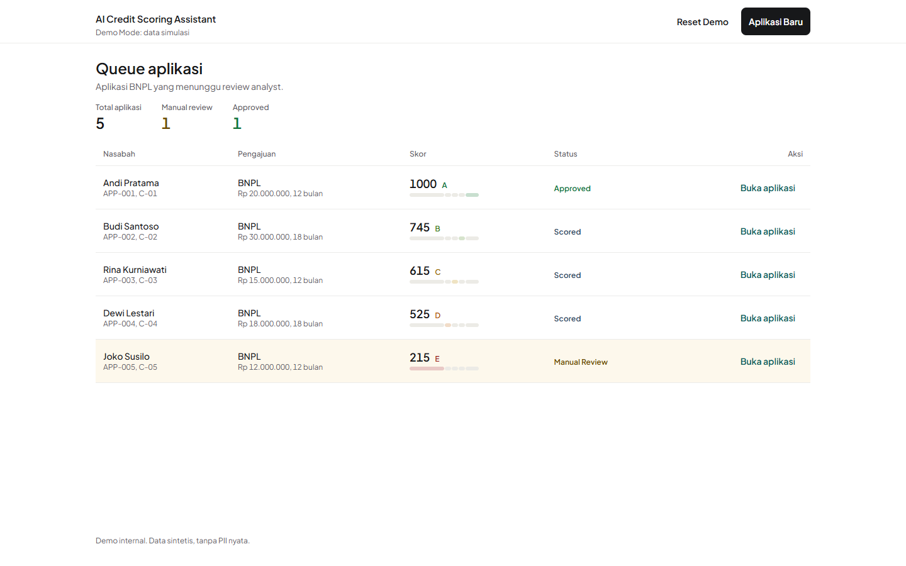
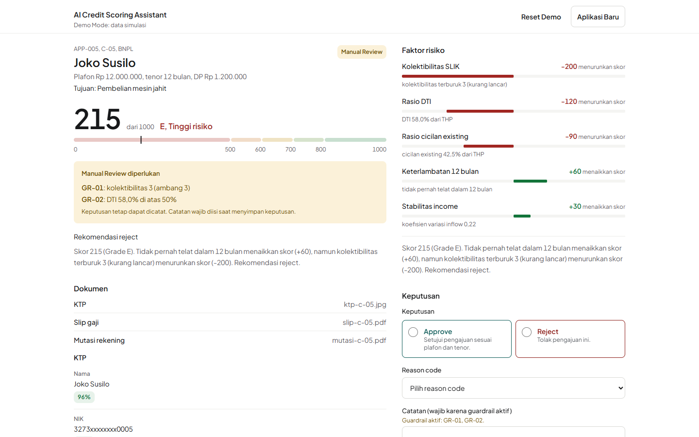
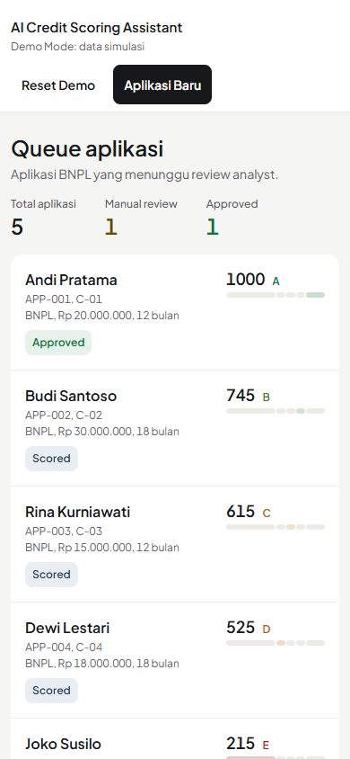
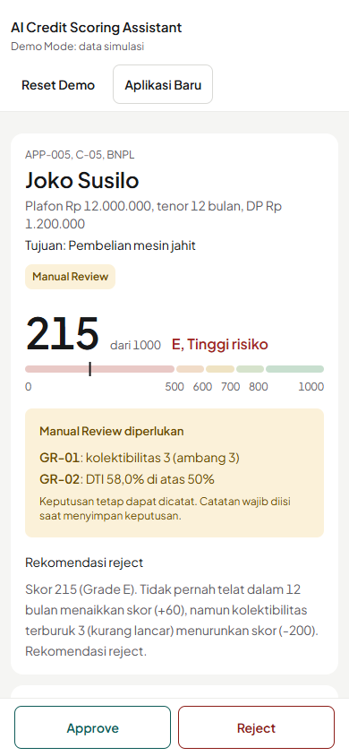

# Product Requirements Document (PRD)
## AI Credit Scoring Assistant — Demo

| Item | Keterangan |
|---|---|
| Versi | 0.4 |
| Tanggal | 17 November 2026 |
| Status | Draft untuk implementasi |
| Mengacu pada | BRD v0.5 (backend minimal dan PWA) |
| Pemilik | TBD |

### Riwayat Revisi

| Versi | Perubahan |
|---|---|
| 0.1 | Draft awal: user stories, layar, scoring, data demo |
| 0.2 | Tambah User Scenario, User Journey, dan Mockup UI/UX; selaraskan persistensi localStorage |
| 0.3 | Selaraskan rujukan BRD v0.4, skema contoh dengan model TRD, dan narasi faktor dengan aturan §12.5 |
| 0.4 | Persistensi pindah ke API server (file JSON), tambah PWA installable dan deliverable QA |

---

## 1. Ringkasan Produk

Satu aplikasi web untuk analyst BNPL yang menampilkan hasil review kredit: skor, alasan skor, guardrail, dan rekomendasi keputusan. Analyst tetap memutuskan.

**Tujuan demo:** memperlihatkan satu aplikasi diproses dari upload dokumen sampai keputusan dalam < 5 menit, dengan alasan yang bisa dijelaskan.

**Bukan tujuan demo:** akurasi prediktif, OCR nyata, integrasi sistem, atau kesiapan produksi.

---

## 2. Persona

**Credit Analyst** — memproses aplikasi BNPL harian. Terbiasa membaca SLIK, slip gaji, dan mutasi rekening. Ingin cepat, tapi butuh alasan yang bisa dipertanggungjawabkan.

**Kebutuhan utama:**
- Melihat semua aplikasi dalam satu daftar.
- Memverifikasi data hasil ekstraksi dokumen.
- Memahami mengapa skor tinggi/rendah.
- Mencatat keputusan beserta alasannya.

---

## 3. User Stories

| ID | Sebagai analyst, saya ingin... | Acceptance Criteria |
|---|---|---|
| US-01 | melihat daftar aplikasi beserta skor dan status | 5 aplikasi tampil; kolom nama, plafon, skor, grade, status; bisa dibuka |
| US-02 | membuat aplikasi baru dan mengunggah dokumen | Form tervalidasi; 3 jenis dokumen dapat diunggah; aplikasi muncul di queue |
| US-03 | memverifikasi hasil ekstraksi dokumen | Field tampil dengan confidence; field < 0,80 ditandai; nilai dapat diedit |
| US-04 | melihat skor dan rekomendasi | Skor 0–1000, grade A–E, rekomendasi plafon/tenor tampil setelah data lengkap |
| US-05 | memahami alasan skor | 5 faktor kontribusi dengan poin dan arah; narasi singkat dalam Bahasa Indonesia |
| US-06 | mengetahui jika aplikasi melanggar kebijakan | Banner guardrail tampil; status berubah menjadi Manual Review |
| US-07 | mengambil dan mencatat keputusan | Approve/Reject tersimpan; reason code wajib; log keputusan tampil |
| US-08 | yakin ini bukan data nyata | Label "Demo Mode: data simulasi" terlihat di semua halaman |
| US-09 | membuka aplikasi dari ponsel | Layout berfungsi pada 390px tanpa horizontal scroll |

---

## 4. User Scenario

### SC-01 — Approve cepat dengan limit disesuaikan

**Profil:** C-02 (skor 745, grade B).

- **Given** aplikasi C-02 sudah diekstrak dan diskor 745 (B).
- **When** analyst membuka detail dan meninjau faktor risiko.
- **Then** analyst melihat rekomendasi plafon maks 80%, memilih **Approve** dengan reason code `OTHER`, status berubah menjadi Approved di queue, dan log keputusan tercatat.

**Yang dibuktikan:** alur keputusan normal selesai < 5 menit dengan rekomendasi yang jelas.

### SC-02 — Menolak aplikasi dengan guardrail

**Profil:** C-05 (skor 215, grade E).

- **Given** C-05 memiliki kolektibilitas 3 dan DTI 58%.
- **When** skor dihitung.
- **Then** status menjadi **Manual Review**, banner menampilkan GR-01 dan GR-02, catatan wajib diisi, analyst memilih **Reject** dengan reason `DELINQUENCY`, dan log menyimpan daftar guardrail aktif.

**Yang dibuktikan:** kebijakan kredit ditegakkan dan alasannya dapat diaudit.

### SC-03 — Mengoreksi hasil ekstraksi

**Profil:** C-03 (skor 615, grade C).

- **Given** field "Cicilan terdeteksi" memiliki confidence 78% dan ditandai perlu verifikasi.
- **When** analyst mengubah nilai cicilan dan menghitung ulang skor.
- **Then** skor, faktor, dan rekomendasi berubah mengikuti nilai koreksi; nilai yang diedit ditandai sebagai hasil koreksi.

**Yang dibuktikan:** analyst tetap memegang kendali atas data yang dipakai model.

### SC-04 — Memproses aplikasi baru dari nol

**Profil:** C-01 (skor 1000, grade A).

- **Given** analyst berada di queue.
- **When** analyst membuat aplikasi baru, memilih C-01, mengunggah 3 dokumen, mengekstrak, dan menghitung skor.
- **Then** skor 1000 (A) tampil dengan rekomendasi approve sesuai pengajuan, dan keputusan dapat disimpan.

**Yang dibuktikan:** alur end-to-end berjalan tanpa langkah manual di luar aplikasi.

### SC-05 — Review dari ponsel

**Profil:** C-04 (skor 525, grade D).

- **Given** analyst membuka aplikasi dari browser ponsel (390px).
- **When** analyst membuka queue dan detail C-04.
- **Then** queue tampil sebagai kartu, detail bertumpuk vertikal, tombol keputusan dapat dijangkau tanpa horizontal scroll.

**Yang dibuktikan:** demo tetap dapat dilakukan dari perangkat mobile.

---

## 5. User Journey

Perjalanan analyst dalam satu siklus review:

| Tahap | Aksi Analyst | Yang Dibutuhkan | Risiko Friksi | Respons Desain |
|---|---|---|---|---|
| 1. Masuk | Membuka aplikasi | Tahu harus mulai dari mana | Bingung melihat daftar | Queue langsung tampil; 3 angka ringkasan |
| 2. Memilih | Memindai daftar dan membuka aplikasi | Prioritas jelas | Aplikasi berisiko terlewat | Skor, grade, dan status terlihat di baris |
| 3. Membuat | Mengisi form dan upload | Cepat, sedikit field | Form panjang | 6 field + 3 slot upload dalam satu layar |
| 4. Verifikasi | Mengecek dokumen vs hasil ekstraksi | Percaya pada data | Tidak sadar ekstraksi salah | Confidence + penanda < 80% + input koreksi |
| 5. Memahami | Membaca skor dan faktor | Alasan yang bisa dijelaskan | Skor terasa black box | Bar +/−, poin, dan narasi 2–3 kalimat |
| 6. Cek kebijakan | Melihat guardrail | Tahu batasan yang dilanggar | Aturan terlewat | Guardrail tepat di bawah skor + status Manual Review |
| 7. Memutuskan | Approve/Reject + reason | Cepat dan tercatat | Alasan tidak standar | Reason code wajib; catatan wajib saat guardrail |
| 8. Menutup | Kembali ke queue | Yakin keputusan tersimpan | Ragu status berubah | Status ter-update + log di detail |
| 9. Mobile | Mengulang alur di ponsel | Akses penuh | Tabel terpotong | Kartu di queue; detail bertumpuk; aksi sticky |

**Momen kunci:** tahap 4 dan 5. Jika analyst tidak percaya pada data atau tidak memahami skor, demo kehilangan nilainya. Kedua tahap harus paling jelas secara visual.

---

## 6. Scope

Mengikuti BRD v0.4. Ringkasnya:

**Ada:** queue, aplikasi baru, upload + ekstraksi simulasi, SLIK simulasi, skor + faktor + guardrail, keputusan + log, 5 profil dummy, responsive.

**Tidak ada:** OCR, database, login, dashboard, what-if, PDF, mobile native, integrasi eksternal.

---

## 7. Alur Pengguna

### 7.1 Happy Path

1. Queue → klik **Aplikasi Baru**.
2. Isi produk, plafon, tenor, DP, tujuan; pilih **Profil Demo** (C-01 s/d C-05).
3. Upload KTP, slip gaji, mutasi rekening.
4. Klik **Ekstrak Dokumen** → loading ±1,5 detik → field hasil ekstraksi + confidence dari API.
5. Analyst memeriksa dan mengoreksi field bila perlu → **Hitung Skor** (dihitung di server).
6. Halaman Detail terbuka: skor, grade, rekomendasi, faktor, SLIK.
7. Pilih **Approve** atau **Reject**, pilih reason code, isi catatan (opsional) → **Simpan Keputusan**.
8. Status di queue berubah; log keputusan tercatat.

### 7.2 Alur Guardrail

1. Skor dihitung → guardrail terpicu.
2. Status menjadi **Manual Review**; banner menampilkan aturan yang dilanggar.
3. Keputusan tetap dapat diambil (demo satu role), tetapi reason code dan catatan wajib.
4. Log mencatat keputusan dan guardrail yang aktif.

### 7.3 Mobile

Queue tampil sebagai kartu. Detail tampil bertumpuk vertikal. Tombol keputusan berada di akhir halaman atau sticky bar.

---

## 8. Spesifikasi Layar

### 8.1 Queue

**Header:** nama aplikasi, label Demo Mode, tombol **Reset Demo**, tombol **Aplikasi Baru**.

**Ringkasan:** 3 angka — total aplikasi, manual review, approved.

**Daftar:** tabel di desktop, kartu di mobile.

| Kolom | Isi |
|---|---|
| Nama | Nama nasabah + ID aplikasi |
| Produk | BNPL / plafon / tenor |
| Skor | Angka + badge grade |
| Status | Draft / Scored / Manual Review / Approved / Rejected |
| Aksi | Buka detail |

**Seed status:** C-01 Approved, C-02 Scored, C-03 Scored, C-04 Scored, C-05 Manual Review.

### 8.2 Aplikasi Baru

Form satu halaman:

| Field | Tipe | Validasi |
|---|---|---|
| Profil Demo | Select C-01…C-05 | Wajib; menampilkan deskripsi singkat kasus |
| Produk | Select (BNPL) | Wajib |
| Plafon | Nominal Rp, titik ribuan otomatis saat diketik | 5–50 juta |
| Tenor | Select 3/6/12/18/24 bulan | Wajib |
| DP | Nominal Rp, titik ribuan otomatis saat diketik | 0 s/d 50% plafon |
| Tujuan | Text | Opsional |

**Upload:** tiga slot — KTP, slip gaji, mutasi rekening. Menerima JPG/PNG/PDF, maks 10 MB. Tombol **Ekstrak Dokumen** aktif jika ketiganya terisi.

**Setelah ekstraksi:** tampilkan daftar field per dokumen dengan nilai, confidence chip, dan input untuk koreksi. Tombol **Hitung Skor**.

### 8.3 Detail Aplikasi

Header: nama, ID, skor besar, badge grade, status. Label Demo Mode ada di header aplikasi.

Urutan bagian:

1. **Ringkasan**
   - Skor 0–1000, grade, dan skala skor.
   - Banner guardrail bila ada, tepat di bawah skor dan skala.
   - Rekomendasi plafon dan tenor.
   - Narasi 2–3 kalimat.
2. **Dokumen**
   - Daftar file yang diunggah (nama file, jenis).
   - Field ekstraksi: label, nilai, confidence (hijau ≥ 0,80; kuning < 0,80).
   - Mode edit untuk koreksi nilai.
3. **SLIK**
   - Tabel fasilitas: lender, jenis, plafon, baki debet, kolektibilitas.
   - Kolektibilitas terburuk ditonjolkan.
4. **Faktor Risiko**
   - 5 bar kontribusi: positif dan negatif, dengan poin.
   - Label faktor dalam Bahasa Indonesia.
   - Narasi alasan utama.
5. **Keputusan**
   - Tombol **Approve** / **Reject**.
   - Reason code (wajib) dan catatan.
   - Tombol **Simpan Keputusan**.
   - Log keputusan aplikasi ini: waktu, keputusan, reason code, catatan, guardrail aktif.

---

## 9. Mockup UI/UX

Empat mockup PNG di bawah adalah acuan visual untuk demo: minimalis, modern, light theme, tanpa dekorasi. Teks pada implementasi mengikuti PRD; token warna, tipografi, dan spacing ditetapkan di `DESIGN.md`.

### 9.1 Queue — Desktop



Skor dan status terbaca sebelum detail produk. Baris dengan status Manual Review harus langsung terlihat berbeda.

### 9.2 Detail Aplikasi — Desktop



Dua kolom: kiri bukti (skor, dokumen, SLIK), kanan faktor risiko dan keputusan. Skor tetap di atas fold.

### 9.3 Queue — Mobile (390px)



Tabel berubah menjadi kartu; tidak ada kolom yang terpotong.

### 9.4 Detail — Mobile (390px)



Detail memakai accordion; action bar keputusan menempel di bawah layar.

### 9.5 Layar Pendukung

Form Aplikasi Baru, hasil ekstraksi, dan banner guardrail tidak memiliki mockup terpisah. Acuannya adalah spesifikasi §8 dan daftar state di §9.6, dengan gaya visual yang sama seperti empat layar di atas.

### 9.6 State Wajib

| State | Tampilan |
|---|---|
| Ekstraksi berjalan | Spinner + "Mengekstrak dokumen…" (1,5 dtk) |
| Ekstraksi selesai | Daftar field + confidence + tombol Hitung Skor |
| Confidence rendah | Chip kuning + label "Perlu verifikasi" |
| Guardrail aktif | Banner + status Manual Review |
| Keputusan tersimpan | Status berubah + entri log baru |
| Queue kosong | Empty state + tombol Aplikasi Baru |
| ID tidak ditemukan | Empty state + tautan kembali ke queue |
| Upload invalid | Pesan error di slot file |

### 9.7 Prinsip UX

1. **Skor dan rekomendasi di atas fold** — analyst tidak perlu scroll untuk jawaban utama.
2. **Bukti dekat dengan kesimpulan** — dokumen dan SLIK berada di kolom yang sama dengan skor.
3. **Warna tidak sendirian** — grade dan status selalu disertai teks.
4. **Satu aksi utama per layar** — Ekstrak, Hitung Skor, atau Simpan Keputusan.
5. **Progressive disclosure di mobile** — accordion, bukan tabel sempit.
6. **Tanpa dekorasi** — tidak ada hero, gradient, glass, atau emoji; ini alat kerja.

---

## 10. Aturan Interaksi & Komponen

- **Badge grade:** A/B hijau, C kuning, D oranye, E merah. Teks tetap ada (tidak hanya warna).
- **Confidence chip:** angka persen; < 80% diberi label "Perlu verifikasi".
- **Bar faktor:** panjang proporsional terhadap poin; tanda +/− eksplisit.
- **Tombol utama:** satu per layar; aksi destruktif (Reject) tidak memakai warna yang sama dengan Approve.
- **Loading:** skeleton singkat untuk queue; spinner + teks "Mengekstrak dokumen…" saat simulasi.
- **Error:** pesan di dekat field, Bahasa Indonesia, tanpa jargon teknis.
- **Angka:** format Rupiah `Rp 12.500.000`; skor tanpa desimal; persen satu desimal.

---

## 11. Data Demo

### 11.1 Profil

| ID | THP | Plafon / Tenor | Cicilan existing | CV income | Selisih slip–mutasi | Kolektibilitas | Telat 12 bln | Skor | Grade |
|---|---|---|---|---|---|---|---|---|---|
| C-01 | 12.000.000 | 20 jt / 12 | 0 | 0,05 | 5% | 1 | 0 | 1000 | A |
| C-02 | 15.000.000 | 30 jt / 18 | 3.400.000 | 0,18 | 12% | 1 | 0 | 745 | B |
| C-03 | 10.000.000 | 15 jt / 12 | 1.500.000 | 0,33 | 28% | 1 | 1 | 615 | C |
| C-04 | 9.000.000 | 18 jt / 18 | 2.400.000 | 0,22 | 20% | 2 | 2 | 525 | D |
| C-05 | 8.000.000 | 12 jt / 12 | 3.400.000 | 0,22 | 18% | 3 | 0 | 215 | E |

Catatan:
- Bunga flat demo: 2% per bulan untuk menghitung cicilan baru.
- C-05 memicu dua guardrail: kolektibilitas 3 dan DTI > 50%.
- Semua nilai sintetis; tidak merujuk individu nyata.

### 11.2 Skema Aplikasi (contoh)

```json
{
  "id": "APP-003",
  "profileId": "C-03",
  "customerName": "Rina Kurniawati",
  "product": "BNPL",
  "plafon": 15000000,
  "tenor": 12,
  "dp": 1500000,
  "purpose": "Renovasi rumah",
  "status": "Draft",
  "documents": [
    { "type": "KTP", "fileName": "ktp.jpg" },
    { "type": "SLIP_GAJI", "fileName": "slip.pdf" },
    { "type": "MUTASI", "fileName": "mutasi.pdf" }
  ],
  "extraction": {
    "ktp": {
      "nama": { "value": "Rina Kurniawati", "confidence": 0.96 },
      "nik": { "value": "3273xxxxxxxx0001", "confidence": 0.93 },
      "tanggalLahir": { "value": "1994-03-12", "confidence": 0.95 }
    },
    "slipGaji": {
      "employer": { "value": "PT Sinar Digital", "confidence": 0.90 },
      "thp": { "value": 10000000, "confidence": 0.88 },
      "masaKerjaBulan": { "value": 26, "confidence": 0.86 }
    },
    "mutasi": {
      "rataRataSaldo": { "value": 4200000, "confidence": 0.84 },
      "inflowBulanan": { "value": 12800000, "confidence": 0.82 },
      "cicilanTerdeteksi": { "value": 1500000, "confidence": 0.78 }
    }
  },
  "log": []
}
```

Field `cicilanTerdeteksi` memakai confidence 0,78 agar kasus koreksi pada SC-03 dapat didemokan. SLIK tidak disalin ke data aplikasi; layar Detail menampilkannya dari profil demo melalui `profileId`.

### 11.3 Mapping Ekstraksi

| Dokumen | Field | Sumber nilai |
|---|---|---|
| KTP | nama, NIK, tanggal lahir | Profil demo terpilih |
| Slip gaji | employer, THP, masa kerja | Profil demo terpilih |
| Mutasi | rata-rata saldo, inflow, cicilan terdeteksi | Profil demo terpilih |
| SLIK | fasilitas, kolektibilitas, keterlambatan | Profil demo terpilih |

Upload berfungsi untuk alur dan preview; nilai diambil dari profil demo, bukan dari isi file. Nilai yang dikoreksi analyst menggantikan nilai profil saat skor dihitung ulang.

---

## 12. Logika Scoring

### 12.1 Perhitungan Fitur

| Fitur | Rumus |
|---|---|
| Cicilan baru | `plafon × (1 + 0,02 × tenor) / tenor` |
| DTI | `(cicilan baru + cicilan existing) / THP` |
| Rasio existing | `cicilan existing / THP` |
| Stabilitas income | koefisien variasi inflow 6 bulan (CV) |
| Selisih slip–mutasi | `abs(THP − rata-rata inflow) / THP` |
| Kolektibilitas terburuk | maksimum dari SLIK |
| Keterlambatan | jumlah telat 1–90 hari dalam 12 bulan |

### 12.2 Poin (Base 520)

| Fitur | Kondisi | Poin |
|---|---|---|
| DTI | ≤ 20% | +120 |
| | 20–35% | +60 |
| | 35–50% | 0 |
| | > 50% | −120 |
| Rasio existing | ≤ 10% | +60 |
| | 10–25% | +20 |
| | 25–40% | −40 |
| | > 40% | −90 |
| Stabilitas income | CV ≤ 0,10 | +80 |
| | 0,10–0,25 | +30 |
| | 0,25–0,40 | −40 |
| | > 0,40 | −90 |
| Selisih slip–mutasi | ≤ 10% | +60 |
| | 10–25% | +15 |
| | 25–50% | −45 |
| | > 50% | −100 |
| Kolektibilitas | 1 | +100 |
| | 2 | 0 |
| | ≥ 3 | −200 |
| Keterlambatan | 0 | +60 |
| | 1–2 | 0 |
| | 3–5 | −60 |
| | > 5 | −130 |
| | ada 90+ hari | −150 |

**Skor = clamp(520 + total poin, 0, 1000).**

### 12.3 Grade & Rekomendasi

| Skor | Grade | Rekomendasi |
|---|---|---|
| 800–1000 | A | Approve, plafon sesuai pengajuan |
| 700–799 | B | Approve, plafon maks 80% pengajuan |
| 600–699 | C | Manual review, plafon maks 50% |
| 500–599 | D | Manual review / approve bersyarat |
| < 500 | E | Rekomendasi reject |

### 12.4 Guardrail

| ID | Aturan | Efek |
|---|---|---|
| GR-01 | Kolektibilitas ≥ 3 | Status Manual Review |
| GR-02 | DTI > 50% | Status Manual Review |
| GR-03 | Ada telat 90+ hari dalam 12 bulan | Status Manual Review |

### 12.5 Faktor & Narasi

- Tampilkan 5 faktor dengan kontribusi terbesar (nilai absolut).
- Setiap faktor: nama, poin, arah (menaikkan/menurunkan), satu kalimat penjelasan.
- Narasi ringkasan: sebut grade, 2 faktor dominan, dan rekomendasi. Contoh:

> Skor 615 (Grade C). Kolektibilitas lancar menaikkan skor (+100), namun selisih slip-mutasi 28% menurunkan skor (−45). Rekomendasi: manual review dengan plafon maksimum 50%.

---

## 13. Keputusan & Log

- Status keputusan: `Approved` atau `Rejected`.
- Reason code wajib untuk kedua keputusan.
- Catatan wajib jika guardrail aktif.
- Log per aplikasi: `timestamp`, `applicationId`, `decision`, `reasonCode`, `notes`, `activeGuardrails`.
- Log hanya ditampilkan; tidak ada fitur edit/hapus.
- Keputusan dapat diubah pada demo (keputusan baru menambah entri log).

**Reason code:** `INCOME_INSUFFICIENT`, `DTI_EXCEEDED`, `DELINQUENCY`, `THIN_FILE`, `DOC_MISMATCH`, `OTHER`.

---

## 14. Pedoman UI

- Alat kerja internal: rapat, tenang, angka mudah dibaca. Tanpa hero, gradient, glassmorphism, atau ilustrasi dekoratif.
- Satu keluarga font sans; angka memakai tabular numerals.
- Warna netral + satu aksen; merah/hijau hanya untuk makna risiko.
- Tanpa emoji. Bahasa Indonesia faktual.
- Kontras WCAG AA, focus ring terlihat, target sentuh ≥ 44px.
- Desktop: lebar konten maks 1200px. Mobile: satu kolom.
- Arah visual final ditulis di `DESIGN.md` sebelum implementasi.

---

## 15. Non-Fungsional

| Kebutuhan | Target |
|---|---|
| Waktu hitung skor | < 1 detik |
| Waktu ekstraksi simulasi | ±1,5 detik |
| Load halaman lokal | < 3 detik |
| Responsive | 390px–1440px |
| Data | file JSON di server lokal; bertahan saat refresh; reset lewat tombol |
| PWA | Manifest + service worker; dapat di-install dari browser |
| Akses | Lokal, tanpa login |
| Privasi | Tidak ada data pribadi nyata |

---

## 16. Edge Case

| Kasus | Perilaku |
|---|---|
| Dokumen belum lengkap | Tombol ekstrak nonaktif + pesan |
| File > 10 MB / tipe salah | Pesan error, file tidak diterima |
| Field confidence < 0,80 | Ditandai "Perlu verifikasi" |
| Guardrail aktif | Status Manual Review + banner |
| Reject tanpa reason code | Tidak dapat disimpan |
| Refresh halaman | Data tetap tersimpan di server |
| Reset Demo / file data dihapus | Data kembali ke seed |
| Server/API tidak berjalan | Pesan error di layar, data tidak berubah |
| Profil demo belum dipilih | Tombol ekstrak nonaktif |

---

## 17. Skenario Demo (5 Menit)

1. **Queue** (30 dtk) — tunjukkan 5 aplikasi dan statusnya.
2. **C-03** (1 mnt) — buka detail, jelaskan skor 615 dan faktor penyebabnya.
3. **Aplikasi baru** (1,5 mnt) — pilih C-02, upload 3 dokumen, tunjukkan ekstraksi + confidence, koreksi satu field, hitung skor.
4. **C-05** (1 mnt) — tunjukkan dua guardrail dan status Manual Review.
5. **Keputusan** (1 mnt) — approve C-02 dengan reason code, tunjukkan log dan perubahan status.
6. **Mobile** (30 dtk) — buka queue di lebar 390px.

---

## 18. Definition of Done

- [ ] `npm install && npm run dev` berjalan tanpa error.
- [ ] 5 profil dan skornya sesuai tabel.
- [ ] US-01 s/d US-09 terpenuhi.
- [ ] SC-01 s/d SC-05 dapat didemonstrasikan.
- [ ] Mockup §9 tercermin di implementasi (struktur, hierarki, state).
- [ ] Tidak ada error di console saat alur demo dijalankan.
- [ ] Layout diuji pada 390px, 768px, dan 1440px.
- [ ] Label Demo Mode terlihat di semua halaman.
- [ ] PWA dapat di-install dari browser.
- [ ] `01_documents/DESIGN.md` tersedia sebelum implementasi UI.
- [ ] Test scenario, automated tests, dan QA report tersedia di `03_qa/`.
- [ ] Presentasi tersedia di `04_presentation/`.

---

## 19. Asumsi & Pertanyaan Terbuka

**Asumsi:** satu pengguna, branding netral, data di server lokal (file JSON), PWA installable, bunga flat 2%/bulan, tanpa integrasi.

**Terbuka:**
1. Audiens demo (internal/eksternal)?
2. Branding/nama produk?
3. Tanggal target demo?

---

## Lampiran — Glosarium

| Istilah | Definisi |
|---|---|
| BNPL | Buy Now Pay Later |
| DTI | Debt-to-Income |
| THP | Take Home Pay |
| CV | Coefficient of Variation |
| SLIK | Sistem Layanan Informasi Keuangan |
| Guardrail | Aturan kebijakan yang memaksa manual review |
| PWA | Progressive Web App; web app installable |

---

## 20. Deliverable Submission

| Folder | Isi |
|---|---|
| `01_documents/` | BRD, PRD, TRD, Testing Plan, DESIGN.md, mockup |
| `02_source/` | Source Next.js, dependency files, schema, seed sintetis |
| `03_qa/` | Test scenario, automated tests, QA report |
| `04_presentation/` | Presentasi final (.pptx) |
